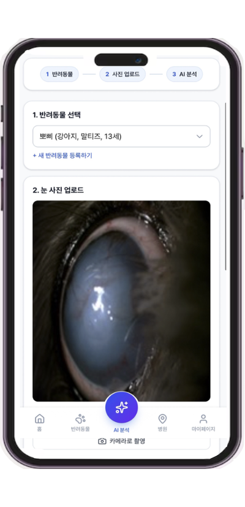
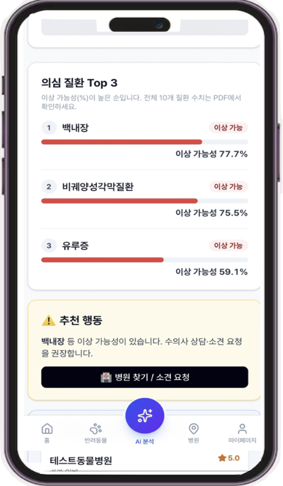
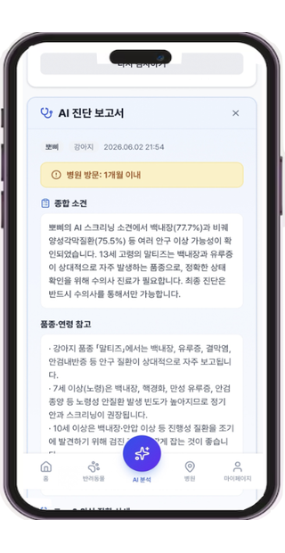
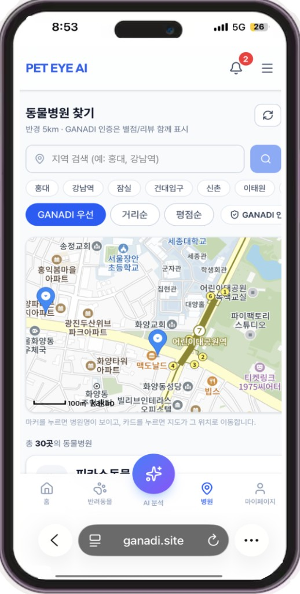
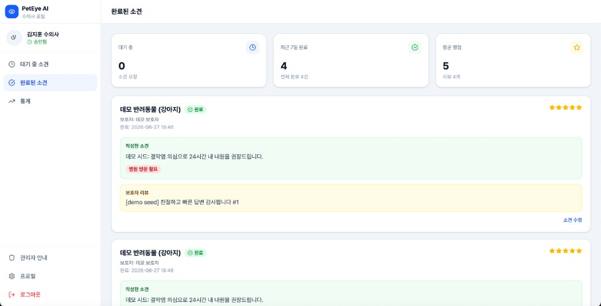
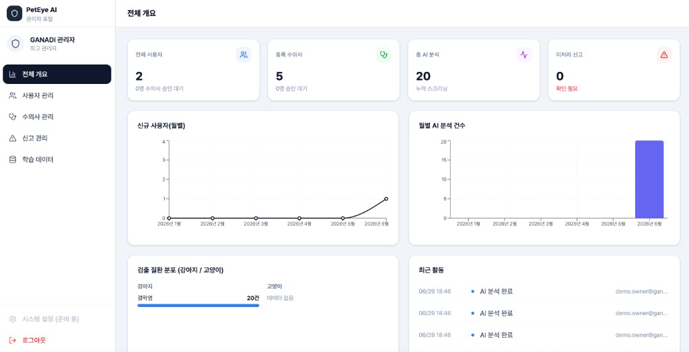
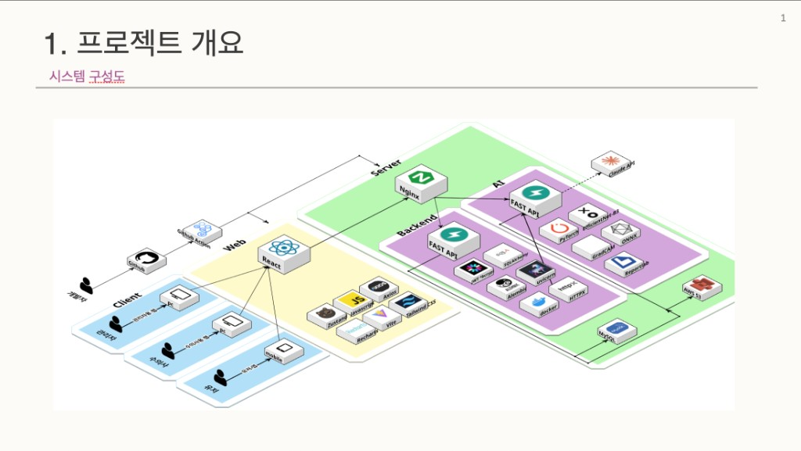

# 🐾 GANADI — 반려동물 안과질환 AI 스크리닝 플랫폼

> 반려동물의 **안구 사진 한 장**으로 10종 안과질환을 AI가 스크리닝하고,  
> 주변 동물병원·수의사 소견까지 연결하는 **모바일 웹(PWA)** 서비스

[](https://ganadi.site)
[](https://ganadi.site)
[](#-기술-스택)

**세종대학교 컴퓨터공학과 캡스톤디자인 2026-1**

---

## 📸 서비스 화면

### 보호자 (모바일 PWA)

<table align="center">
  <tr>
    <td align="center" valign="top"></td>
    <td align="center" valign="top"></td>
    <td align="center" valign="top"></td>
    <td align="center" valign="top"></td>
    <td align="center" valign="top"></td>
  </tr>
</table>

| 화면 | 설명 |
|------|------|
| **반려동물 관리** | 보호자·반려동물 프로필 등록, AI 분석 진입 |
| **사진 업로드** | 카메라 촬영 또는 갤러리 업로드 → 안구 크롭 |
| **Top-3 결과** | 10종 질환 중 의심 Top-3 + 병원 방문 CTA |
| **AI 리포트** | Claude API 기반 자연어 종합 소견 + PDF 다운로드 |
| **병원 찾기** | Kakao Map 연동, GANADI 인증 병원 우선 표시 |

### 수의사 · 관리자 포털 (PC)

<p align="center">
  
  
</p>

| 역할 | 주요 기능 |
|------|-----------|
| **수의사** | 소견 요청 수신·작성, 완료 이력·평점 관리 |
| **관리자** | 사용자/수의사 승인, 신고 처리, 월별 통계·학습 데이터 수집 |

---

## 🏗 시스템 아키텍처

<p align="center">
  
</p>

```
┌─────────────┐     ┌─────────────┐     ┌─────────────┐
│  React PWA  │────▶│  FastAPI     │────▶│  AI Server  │
│  (모바일)    │     │  REST API    │     │  ONNX 추론  │
└─────────────┘     └──────┬──────┘     └──────┬──────┘
                           │                    │
                    ┌──────┴──────┐      ┌─────┴──────┐
                    │ MySQL (RDS) │      │ Claude API │
                    │ S3 (이미지)  │      │ ReportLab  │
                    └─────────────┘      └────────────┘
```

| 계층 | 역할 |
|------|------|
| **Frontend** | React + Vite PWA, Zustand 상태관리, Kakao OAuth/Map |
| **Backend** | JWT 인증, 반려동물·AI 스크리닝·소견·알림 API, S3 업로드 |
| **AI Server** | EfficientNet-B3 멀티태스크 추론, GradCAM, PDF 생성 |
| **Infra** | AWS EC2, Docker Compose, Nginx, HTTPS (`ganadi.site`) |

---

## ✨ 주요 기능

### 🤖 AI 스크리닝

- 안구 사진 → **10종 질환 Top-3** 스크리닝 (강아지 10 / 고양이 5)
- **EfficientNet-B3** 멀티태스크 모델 (질환별 분류 헤드) — 10-class **Softmax 감별 헤드**는 오프라인 실험으로 검증
- **ONNX 경량화**: FP32 ~38ms (PyTorch ~440ms 대비 약 11×), 배포 기본값 **INT8은 ~18MB · ~56ms** (CPU 기준)
- **Claude API** 기반 AI 스크리닝 결과 자연어 해석 + **ReportLab PDF** 리포트
- 의료법 준수: "진단"이 아닌 **"AI 스크리닝 소견"** 표현 사용

### 📱 서비스 기능

- 카메라 촬영 → 안구 크롭 → 실시간 AI 분석
- Kakao Map 기반 주변 동물병원 + **GANADI 인증** 병원 필터
- **보호자 / 수의사 / 관리자** 3종 포털
- Kakao OAuth 로그인, **Web Push** 알림, 스크리닝 이력 관리

---

## 🔬 AI 성과

### 질환 감별 — Softmax 감별 헤드 도입 전·후 (오프라인 평가)

> 강아지 모델, TL random split **검증(Validation) 세트**. Softmax 감별 헤드 도입 전·후 비교.

| 지표 | 개선 전 | 개선 후 |
|------|---------|---------|
| **Top-1 정확도** (비정상 샘플) | 27.25% | **53.77%** (≈2×) |
| **Top-3 정확도** (비정상 샘플) | 51.65% | **84.35%** (+32.7%p) |
| **Device 의존성** (촬영장비별 정확도 최대−최소) | 9.08%p | **2.72%p** |

**이 수치가 측정하는 것과 한계**

- Top-1/Top-3: 검증 세트의 **비정상(질환) 이미지만** 대상으로, 10종 질환 중 정답 질환이 예측 1위 / 3위 안에 든 비율입니다. 정상 눈 이미지는 계산에 포함되지 않습니다.
- Device 의존성: 검증 세트를 촬영장비(스마트폰·검안경 등)별로 나눠 질환 헤드 정확도를 구했을 때 장비 간 최대−최소 차이입니다 (`train_random_split.evaluate_device_subsets` 정의).
- 같은 검증 세트를 체크포인트 선택(best val loss)에도 사용했고 **별도 hold-out 테스트 세트가 없어** 일반화 성능보다 낙관적일 수 있습니다.
- **정상 눈에 대한 오탐률(false-positive rate)은 측정·보고하지 않았습니다.**
- 결과 파일(JSON/CSV)은 저장소에 포함되어 있지 않습니다. 평가 스크립트: [`models/classifier/eval_multitask_softmax.py`](models/classifier/eval_multitask_softmax.py) (AI Hub 원본 데이터 필요).
- **보고 지표는 오프라인 평가 기준입니다.** 현재 배포 추론 코드([`api/inference_onnx.py`](api/inference_onnx.py))는 `*_best_random_split(_int8).onnx`(질환별 헤드 `head_*` 출력만 포함)를 로드하며, Softmax 감별 헤드 모델이 배포에 적용됐다는 근거는 이 저장소에 없습니다.

### 배포 모델 경량화 — ONNX (강아지 모델, CPU 추론)

| 형식 | 모델 크기 | 추론 시간 (CPU) |
|------|-----------|-----------------|
| PyTorch `.pth` | ~214MB | ~440ms |
| ONNX FP32 | ~71MB | **~38ms** (약 11×) |
| ONNX INT8 (Dynamic, **배포 기본값**) | **~18MB** | ~56ms (약 8×) |

- INT8은 FP32 대비 일부 경계 샘플에서 Top-1 순위가 달라질 수 있습니다.
- 파일별 상세·생성 방법: [`models/classifier/checkpoints/README.md`](models/classifier/checkpoints/README.md)

---

## 🛠 기술 스택

| 영역 | 기술 |
|------|------|
| **Frontend** | React, TypeScript, Vite, Tailwind CSS, Zustand, PWA |
| **Backend** | FastAPI, JWT (bcrypt), SQLAlchemy, Alembic, httpx |
| **Database** | MySQL (AWS RDS), AWS S3 |
| **AI/ML** | PyTorch, EfficientNet-B3, ONNX Runtime, GradCAM |
| **External API** | Claude API, Kakao OAuth, Kakao Map |
| **Infra** | Docker Compose, AWS EC2, Nginx, GitHub Actions |

---

## 👤 담당 역할

4인 캡스톤 팀의 팀장으로 아키텍처 설계, AI 파이프라인(데이터 분할·학습·ONNX 경량화), 백엔드·프론트엔드 핵심 구현과 AWS 배포를 맡았고, 팀원들은 수의사 소견서 PDF 기능과 UI 개선·QA를 분담했습니다.

- 시스템 아키텍처 설계 (React PWA · FastAPI 백엔드 · AI 추론 서버 분리, Docker Compose)
- 데이터 분할(TL random split), 멀티태스크 학습·평가, ONNX 변환·INT8 양자화, 추론 API
- FastAPI 백엔드·DB 스키마·JWT 인증, React PWA 핵심 화면 (보호자·수의사·관리자)
- AWS EC2 프로덕션 배포 및 `ganadi.site` 운영

---

## 🤝 팀과 저장소

- **이 모노레포(`capstone_petcare`)가 개발 기준 저장소(source of truth)** 이고, 조직 저장소 [GANADI-frontend](https://github.com/GANADI-Capstone/GANADI-frontend) · [GANADI-backend](https://github.com/GANADI-Capstone/GANADI-backend) · [GANADI-AI](https://github.com/GANADI-Capstone/GANADI-AI) 는 각각 `frontend/` · `backend/` · `api/`+`models/` 를 동기화한 미러입니다 ([동기화 절차](docs/GANADI_ORG_SYNC.md)).
- 팀원 커밋은 조직 저장소에 원본 이력이 있고, 이 모노레포에는 동기화 커밋으로 반영했습니다. 단, 2026-06-01 수의사 소견서 PDF(`/api/ai/opinion-pdf`) 관련 커밋은 현재 조직 저장소에만 있습니다.

| 팀원 (GitHub 핸들 / 커밋 작성자명) | 기여 |
|------|------|
| `@leejunyoung0610` (팀장) | 아키텍처, AI 파이프라인, 백엔드·프론트엔드 핵심 구현, AWS 배포·운영 |
| `@woojin-archive` | 수의사 소견서 PDF 생성 (AI 서버 엔드포인트 · 백엔드 API · 프론트 다운로드 흐름), 관리자 사용자 정지 해제 버튼, 질환 라벨·안내 문구 수정 |
| `@wldn7601` | nginx CSP 헤더 수정, React Hooks 호출 순서 버그(React error #310) 수정, 소견서 PDF 한글 파일명 인코딩, 수의사 화면 이미지 표시 수정 |
| 박민지 | 헤더 중복·신고 시간 표기·반려동물 삭제 반영·알림 아이콘 등 UI 버그 수정 및 버튼 디자인 통일 |

---

## 🚀 실행 방법

### 빠른 시작 (모노레포 로컬)

```bash
git clone https://github.com/leejunyoung0610/capstone_petcare.git
cd capstone_petcare

# 1) AI 서버 (포트 8000 또는 8010)
python -m venv venv && source venv/bin/activate
pip install -r requirements.txt
uvicorn api.main:app --reload --host 0.0.0.0 --port 8000

# 2) 백엔드 (포트 8001) — 별도 터미널
cd backend && python -m venv venv && source venv/bin/activate
pip install -r requirements.txt
cp .env.example .env   # DATABASE_URL, AI_SERVER_URL 설정
alembic upgrade head
python -m app.main

# 3) 프론트 (포트 5173) — 별도 터미널
cd frontend && npm install && npm run dev
```

브라우저: **http://localhost:5173**

상세 가이드 (MySQL, 시드 데이터, 환경변수): [`docs/GANADI_LOCAL_RUN.md`](docs/GANADI_LOCAL_RUN.md)

### 프로덕션 (Docker Compose)

`backend/docker-compose.prod.yml` 은 **오버라이드 파일**이라 단독으로 실행할 수 없고, 항상 `docker-compose.yml` 과 함께 지정합니다. 프론트 이미지는 이 저장소의 `frontend/` 를 빌드합니다.

```bash
cd backend
cp .env.production.example .env   # SECRET_KEY, RDS_ENDPOINT, DB_PASSWORD, VITE_KAKAO_MAP_KEY, AI_INTERNAL_TOKEN 등
cp api/.env.example api/.env      # ANTHROPIC_API_KEY, INFERENCE_BACKEND=onnx_int8
# 모델 파일(Git 미포함)을 backend/models/classifier/checkpoints/ 에 배치
#   예: dog_best_random_split_int8.onnx, cat_best_random_split_int8.onnx
# SSL 인증서: /etc/ssl/ganadi/ganadi.pem, ganadi.key

./scripts/deploy-prod.sh          # 환경 검사 → 빌드·기동 → 헬스체크·스모크 테스트
# 수동 실행 시:
docker compose -f docker-compose.yml -f docker-compose.prod.yml up -d --build
```

배포 상세: [`docs/DEPLOYMENT.md`](docs/DEPLOYMENT.md)

---

## 📁 프로젝트 구조

```
capstone_petcare/
├── frontend/          # React PWA (Vite)
├── backend/           # FastAPI · MySQL · JWT
├── api/               # AI 추론 · Claude · PDF
├── models/classifier/ # 학습·ONNX·벤치마크
├── screenshots/       # README용 서비스 캡처
└── docs/              # 로컬 실행·배포 문서
```

---

## 📚 추가 문서

| 문서 | 내용 |
|------|------|
| [docs/PROJECT_DOCUMENTATION.md](docs/PROJECT_DOCUMENTATION.md) | 전체 기능·API·모델 상세 |
| [docs/GANADI_LOCAL_RUN.md](docs/GANADI_LOCAL_RUN.md) | 로컬 3-tier 실행 |
| [models/classifier/checkpoints/README.md](models/classifier/checkpoints/README.md) | 모델 파일·ONNX 벤치마크 |

---

## ⚠️ 면책

본 서비스는 **의료 진단을 대체하지 않습니다.** AI 결과는 참고용 스크리닝 소견이며, 정확한 진단·치료는 반드시 수의사와 상담하세요.

---

## 📄 라이선스

세종대학교 컴퓨터공학과 캡스톤디자인 프로젝트 (2026)
